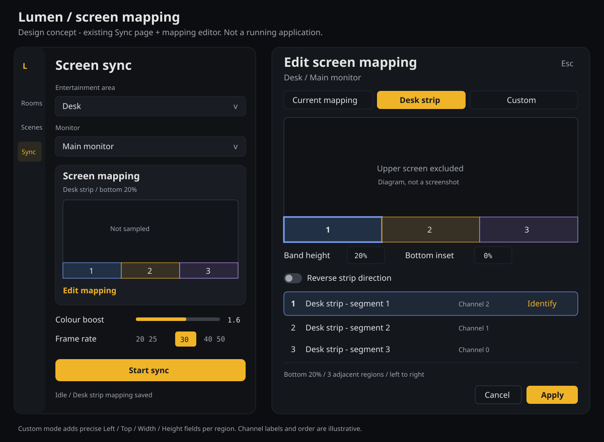

# Lumen configurable screen mapping

Status: researched implementation proposal, 6 November 2026. No feature implementation or installed-app replacement yet.

Fork: https://github.com/magnusmk2/Lumen
Baseline: PierreSylla/Lumen commit `fde87a2f328afc7fe195c8af03f48f8f5b3d3429`, package version 0.8.0.
Design branch: `design/screen-region-mapping`.



The visual is a static layout concept. The implemented diagram must use the selected monitor's real aspect ratio.

## Outcome

Update: [Source topology research](hue-source-topology.md) refines the Desk strip preset below. Reported segment coverage, equal widths and custom widths must be distinct choices. The initial equal-thirds example is not an assumption about physical strip coverage.

Allow each Hue Entertainment channel to follow an explicit rectangle of one selected monitor. The first use case is a horizontal gradient desk strip: left, centre and right segments follow only the bottom band of the screen. Provide a quick preset, an honest visual preview and precise adjustment, while retaining Lumen's existing full-height mapping for existing users.

This is a sampling feature. Capture can still acquire the whole selected monitor and downscale it before sampling; selecting a bottom band does not narrow the compositor's capture permission or guarantee lower capture/GPU cost.

## Research and current behavior

Reviewed README, LICENSE, CLAUDE.md, config.py, sync.py, capture.py, portal.py, entertainment.py, webapp.py, SyncPage.vue, store/index.js, App.vue, Sheet.vue, i18n and design tokens at the baseline. There is no AGENTS.md or dedicated CONTRIBUTING file in the checkout. CLAUDE.md has useful project conventions, but parts are stale: it describes QtDBus portal behavior while current portal.py uses GDBus. Treat executable source as the authority.

- GPL-3.0-or-later permits a fork and redistribution with the applicable license/source obligations.
- README documents x-based screen slices and explicitly puts vertical mapping in "Ideas for later".
- `sync.channel_regions()` uses each channel's Hue x coordinate, ignores y/z, and samples a 40%-wide band centered on x across the full screen height, clipped at the edges. These are overlapping bands, not equal thirds.
- For an illustrative three-channel area at x=-0.4, 0, +0.4, the normalized default rectangles are approximately [0.1,0,0.5,1], [0.3,0,0.7,1], [0.5,0,0.9,1]. Rounding happens at capture resolution.
- Channel IDs are sorted for the Hue stream. Spatial order can differ from numeric ID order. Never infer left-to-right from channel number or a repeated lamp name.
- `ScreenCapture(regions=...)` already accepts pixel rectangles. `configure()` generates defaults only when regions is empty. This is the extension seam.
- Capture produces 64x36 frames, RGB or RGBA depending on backend. `region_average()` accepts end-exclusive pixel boxes.
- `WebSync` wraps the shared streaming worker; `_PreviewCapture` exposes the output colours. All Python API calls belong in the Vue store. Strings belong in Python's shared English/French dictionaries.
- SyncPage currently shows equal-width colour blocks without actual sampling bounds. The page marks running after a worker is launched, before the first captured frame, and does not continually reconcile worker errors.
- UI is Vue 3 inside GTK/WebKit pywebview, with IBM Plex Sans/Mono, amber accent, dark/light CSS tokens, cards, and bottom sheets. There is no reason to add Qt or a canvas/chart dependency.
- `config.save_config()` currently shallow-merges and rewrites a credential-bearing file. Mapping persistence needs serialized atomic updates and must preserve unrelated settings.
- Current README recommends wf-recorder on Hyprland. That path avoids Lumux's in-process GStreamer capture failure, but Lumen's behavior on this machine has not been tested. A successful build would not prove capture, DTLS or HDR correctness.

Source references:
- [README](https://github.com/PierreSylla/Lumen/blob/fde87a2f328afc7fe195c8af03f48f8f5b3d3429/README.md)
- [Mapping and streaming](https://github.com/PierreSylla/Lumen/blob/fde87a2f328afc7fe195c8af03f48f8f5b3d3429/huectl/sync.py)
- [Capture and averaging](https://github.com/PierreSylla/Lumen/blob/fde87a2f328afc7fe195c8af03f48f8f5b3d3429/huectl/capture.py)
- [Web API and worker](https://github.com/PierreSylla/Lumen/blob/fde87a2f328afc7fe195c8af03f48f8f5b3d3429/huectl/webapp.py)
- [Current Sync UI](https://github.com/PierreSylla/Lumen/blob/fde87a2f328afc7fe195c8af03f48f8f5b3d3429/webui/src/pages/SyncPage.vue)

## Product design

Keep the existing Sync navigation entry. Its main page becomes:

1. Entertainment area selector and monitor selector.
2. Screen mapping card: exact aspect-ratio diagram, selected mapping summary and an Edit mapping button.
3. Existing colour boost and FPS controls.
4. Start/Stop button and persistent status/error text.

The mapping card shows numbered outlines over a neutral screen diagram and channel swatches underneath. Outline numbers match channel rows; the selected region has a thicker outline and a label, so colour is not the only identifier. Regions use exact bounds, including overlap. Live channel swatches use the actual sampled output; the neutral screen diagram is not presented as a screenshot. No extra capture starts just because the editor is open.

Add a MappingEditorSheet using the existing Sheet pattern and tokens. Use a draft model with Cancel and Apply, not a disk write for every pointer movement. Reuse FieldInput, AppButton, ToggleSwitch and inline SVG icons where appropriate. Sheet must trap focus, close on Escape and return focus to Edit mapping; improve Sheet with opt-in dialog behavior so existing sheets do not regress.

The sheet contains:
- Preset selector: **Current mapping**, **Desk strip**, **Custom**.
- A screen diagram with labelled rectangles; selecting a row selects its rectangle and vice versa.
- A channel list with distinct labels such as "Desk strip - segment 1 (channel 2)" instead of three indistinguishable lamp names.
- For the selected channel: Left, Top, Width, Height in percentages; pointer drag and resize handles are optional accelerators, never the only means of editing.
- Context controls for Desk strip: Band height, Bottom inset, Reverse strip direction.
- A concise summary: "Bottom 20% of the screen; 3 segments; left to right."
- Cancel and Apply. Unsaved edits remain visibly drafts.

Use the current tokens and typography families, with readable control text, visible focus rings and generous hit areas. Existing tiny mono captions must not become the primary instructions. Support light/dark themes, reduced motion and keyboard editing. At narrow window sizes put controls below the diagram; keep the footer actions reachable while content scrolls. Design for desktop mouse/keyboard at desk viewing distance, English default and French parity.

### Preset behavior

**Current mapping** exactly reproduces upstream's 40%-wide x bands and full height. Merely upgrading or opening settings changes no existing color behavior.

**Desk strip** defaults to a bottom band of 20%, bottom inset 0%, partitioned into N contiguous equal-width rectangles. Derive left-to-right channel order from x; retain deterministic channel-ID tie-breaking. If x positions coincide, show a warning and allow explicit reorder rather than pretending the physical order is known.

For three channels:
- Left: x 0-33.33%, y 80-100%.
- Centre: x 33.33-66.67%, y 80-100%.
- Right: x 66.67-100%, y 80-100%.

A 64x36 frame resolves that band to roughly eight rows. Show the effective pixel size in advanced help. Offer Band height 5-100% and Bottom inset 0-95%, constrained so height + inset <=100%. The initial 20% is a proposed starting point, adjustable after a real visual test.

Reverse changes channel assignment, not the screen content. "Segment 1" is not automatically the physical left end. Provide an explicit Identify segment action: while regular sync is stopped, temporarily illuminate one chosen channel at low brightness for a short bounded test, then stop/release the stream in finally. Explain that it changes the lights; it must never run on hover or automatically. Test restoration behavior on the real bridge before claiming previous light state is preserved.

Switching to **Custom** retains the resolved rectangles from the chosen preset. Every channel can then have its own rectangle; overlap and gaps are valid. No disabled-channel mode in v1, avoiding unclear black/retain-state semantics.

Bottom inset can skip a taskbar, subtitle strip or letterbox bar. This is a fixed user choice; automatic black-bar detection is outside v1. Coordinates refer to the captured monitor as supplied by the backend, not desktop-wide logical coordinates. Do not mirror sampling for RTL interface layout.

### Honest runtime feedback

Show Idle, Starting, Waiting for screen selection, Running, Stopping and Error based on worker state. Running requires both the Hue transport setup and first successfully captured/sent frame. Capture backend events should drive Waiting, rather than guessing from elapsed time.

The Vue store owns one lifecycle-aware status/preview poll while the Sync page is mounted. Read status before preview, prevent overlapping requests, stop polling on unmount, and reconcile background errors. Preview messages identify channel IDs and mapping revision, not just array indexes.

Start is disabled for missing pairing, no area/channels, an unavailable saved monitor, invalid mapping or an unresolved channel-layout change. Error text stays visible until a new attempt or dismissal. Applying a mapping must report saved/applied success or a specific failure.

## Persistence and channel identity

Store normalized end-exclusive bounds [left, top, right, bottom] as finite fractions in [0,1]. Percentages are presentation only. Keep this inside the existing config; never expose bridge credentials in mapping API responses or exports.

Proposed dedicated key:

```json
{
  "sync_mapping": {
    "version": 1,
    "bridge_id": "<stable bridge resource identity>",
    "selected_area_id": "<entertainment configuration UUID>",
    "profiles": {
      "<area UUID>": {
        "<monitor connector name>": {
          "preset": "desk_strip",
          "band_height": 0.2,
          "bottom_inset": 0.0,
          "channel_order": [2, 1, 0],
          "rectangles": {
            "2": [0.0, 0.8, 0.3333333333, 1.0],
            "1": [0.3333333333, 0.8, 0.6666666667, 1.0],
            "0": [0.6666666667, 0.8, 1.0, 1.0]
          },
          "channel_signature": "<canonical channel IDs and service membership>"
        }
      }
    }
  }
}
```

Rectangles are the effective source of truth for saved custom/desk profiles; preset parameters describe how to regenerate them only after an explicit user action. Current mapping is computed from current channel positions and needs no rectangles persisted. This avoids disagreeing preset and rectangle calculations.

Key profiles by area and concrete monitor output, bind the collection to the bridge identity, and resolve Automatic to a concrete monitor before selecting a profile. Monitor resolution changes preserve normalized bounds. Do not reuse a profile across bridges merely because channel IDs match. A channel ID is meaningful only inside its area, and service membership is needed to detect IDs being reused after area edits.

Missing mapping key means legacy behavior. Unknown schema version or corrupt profile must produce a recoverable warning; do not overwrite it silently. If a custom profile's channel signature changes, block its application, show changed/missing channels and offer explicit regeneration or remapping. Retain the previous profile until replaced. Switching monitor/area never silently moves custom rectangles to a different device.

Add a process-local lock plus same-directory temporary file/atomic replace for read-modify-write, create secret-bearing files with mode 0600 from creation, preserve existing keys and serialize nested profile updates. Cross-process edits between a running CLI and GUI need a small file-lock strategy or explicit read-only CLI settings in v1. Proposed v1 CLI is read-only with respect to config; writes happen through the GUI.

## Backend design

Add a small dependency-free `huectl/mapping.py` with:
- validate_profile(profile, channel_metadata): strict schema/type/range checks, channel completeness, finite numbers and supported version.
- resolve_profile(config, bridge_id, area_id, output): explicit fallback and mismatch result.
- legacy_regions(config): preserve current formulas.
- desk_strip_regions(channels, band_height, bottom_inset, channel_order): normalized rectangles.
- to_pixel_regions(rectangles, width, height): bounded, nonempty, end-exclusive boxes sorted by channel ID.
- describe_mapping(...): effective normalized and pixel bounds for the UI.

Use shared cut points for adjoining desk rectangles so odd dimensions leave no gap or double-counted boundary. Validate normalized geometry before pixel conversion. A positive normalized rectangle must cover at least one pixel after conversion; never divide by zero. Keep protocol order by channel ID while visual order is independent.

ScreenCapture keeps an immutable mapping request/revision. On the sampling thread, resolve a pending validated mapping into a complete region list and replace the snapshot between frames. Do not mutate the live list from pywebview API threads. Mapping changes do not restart capture or DTLS. Apply validation failures preserve the prior mapping.

Pass the selected area, bridge identity and output consistently into configure/runtime resolution. Extend the existing default path rather than creating a GUI-only sampler. CLI and GUI must resolve the same profile and rectangles.

Proposed API additions:
- get_sync_mapping(area_id, output): sanitized channel metadata, saved profile, effective regions, validation state.
- save_sync_mapping(area_id, output, profile, expected_revision): validate, serialize save and queue runtime apply; return revision and effective mapping.
- select_sync_area(area_id): persist selection; area changes while syncing require an explicit stop/change/start sequence because the Hue stream/config ID changes.
- identify_sync_channel(area_id, channel_id): bounded exclusive test, refused while sync is active.
- Extend sync_status/preview with state, error, area/output, active mapping revision and channel-keyed colours.

Reuse existing list_configs and monitor discovery. A stale editor revision is rejected with "Settings changed; reload this mapping" rather than overwriting another update.

The CLI reads saved mapping for the resolved area/output, supports `--mapping legacy|saved|desk-strip` plus `--band-height` and `--bottom-inset` for temporary overrides, and prints the effective mapping with a read-only `--show-mapping`. Explicit flags take precedence, then saved profile, then legacy. `--test` ignores screen mapping and should say so. CLI settings are not persisted implicitly.

No changes to HueStream frame encoding, DTLS identity rules or sRGB colour conversion are needed for the mapping feature.

## Delivery sequence and gates

1. **Capture baseline and fork hygiene.** Keep upstream remote, GPL notices and attribution. Inventory dependencies without installing; record the baseline hash. Check wf-recorder monitor selection, first frame and stop behavior on the target desktop before spending time on the editor. Keep Lumux installed as rollback and avoid running two Entertainment clients together.
2. **Pure mapping engine and persistence.** Implement normalized profiles, backward-compatible legacy resolution, channel identity validation and atomic config updates. Add meaningful synthetic tests.
3. **Shared runtime and truthful state.** Integrate GUI/CLI profile loading, worker-owned region swaps, status/preview revision data and reliable failure cleanup. Exercise missing recorder, refused portal, no frames and disappearing monitor.
4. **Native-feeling editor.** Add the area selector, accurate diagram and MappingEditorSheet with presets, percentages, reverse/order controls, draft/apply/cancel and translated strings. Wire only through the store. Add bounded Identify after the ordinary sync path is proven.
5. **Hardware acceptance and docs.** Confirm physical direction, apply desk preset, use top/bottom contrast test frames, measure overhead and validate close/reopen/tray behavior. Document installation and recovery. Only then choose whether to replace Lumux autostart.

Each step is independently reviewable. Implement on feature branches; the initial design branch contains documentation only. No upstream issue/PR or message is sent as part of this plan.

## Verification and acceptance criteria

- Golden regression: missing profile produces exactly upstream's legacy pixel rectangles, including x=-1/+1 and clipping.
- Geometry tests: one channel, three channels with nonsequential IDs, duplicate positions, odd frame sizes, RGB/RGBA, minimum rectangles, boundaries, nonfinite numbers, reversed bounds and bad schema.
- Synthetic image test: bright red top and blue bottom yields blue only for bottom-band mapping; upper content changes cannot affect sampled output. Three distinct bottom blocks produce the correct channel colours with reversal. Disable boost or compare raw RGB in these tests.
- Profile tests: preserve credentials/unrelated settings, restrictive file permissions, save interruption, area/bridge/monitor isolation, changed membership, stale revision and old config migration.
- Runtime tests: applying mapping swaps a complete region set between frames without capture/DTLS restart; worker errors update the UI; stop/timeout cleanup releases the area and subprocesses. No overlapping sessions after rapid start/stop.
- UI checks: production Vue build, Python syntax/import checks, English/French key parity, actual pywebview screenshots, narrow window, text scaling, dark/light, keyboard-only editing, focus return and Cancel leaving runtime/disk unchanged.
- Live proof: explicitly select a monitor, verify strip order and bottom-only influence, run 30 minutes with repeated window close/reopen and 10 start/stop cycles. Measure CPU and game/frame-time impact before/after under comparable conditions; make no performance claim until measured.
- Mapping math target: under 1 ms per frame at existing 64x36 capture for a representative 10-channel area on the target machine; measure and report, not assume.
- HDR, protected video and portal compatibility remain separate capture limitations. Do not claim calibrated color or DRM capture support.

## Deferred scope

Automatic letterbox detection, smoothing parity with Lumux, per-channel brightness/gamma, multiple simultaneous monitor sources, area creation, cloud sync, importing credentials from another app, HDR tone mapping and packaging redesign. The schema can grow by versioning, but v1 should remain one monitor, one area and one rectangle per channel.

## Recommended first configuration

After implementation and hardware verification: select the desk Entertainment area and intended monitor, choose Desk strip, start with a 20% bottom band and zero inset, identify direction and reverse if needed. Adjust band height/inset by eye. Keep color boost and FPS as the existing independent controls.

## Decision

Build this as a focused extension to the existing Sync page and shared sampler. Preserve upstream behavior by default, make the actual sampling regions visible, and make the desk preset useful in one selection. Capture reliability is an implementation gate, not a promised benefit of the fork.
